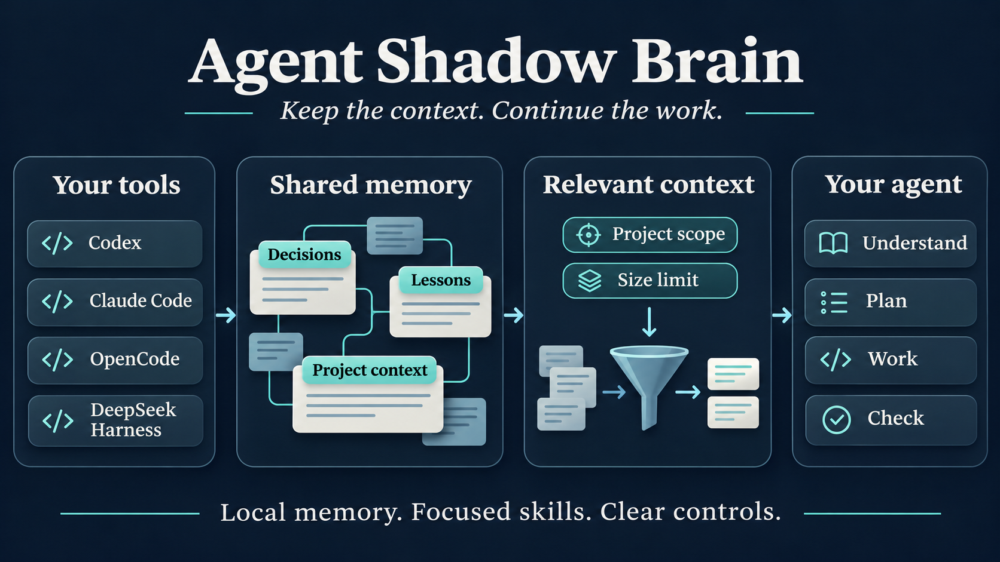
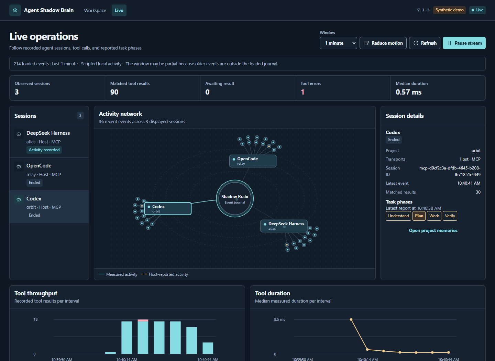
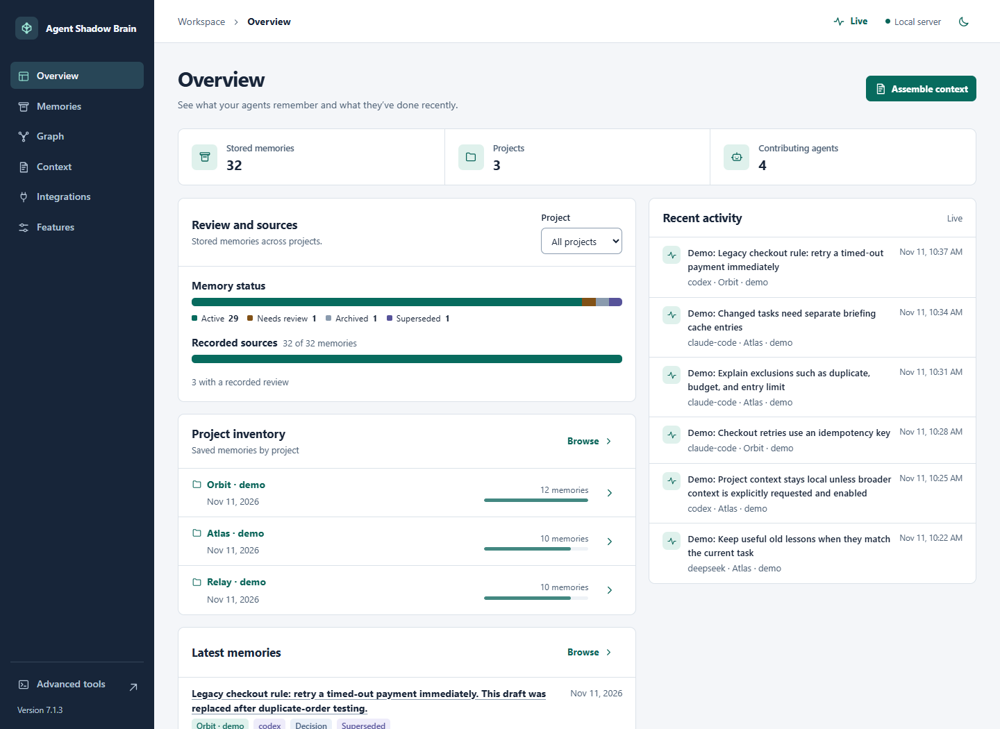
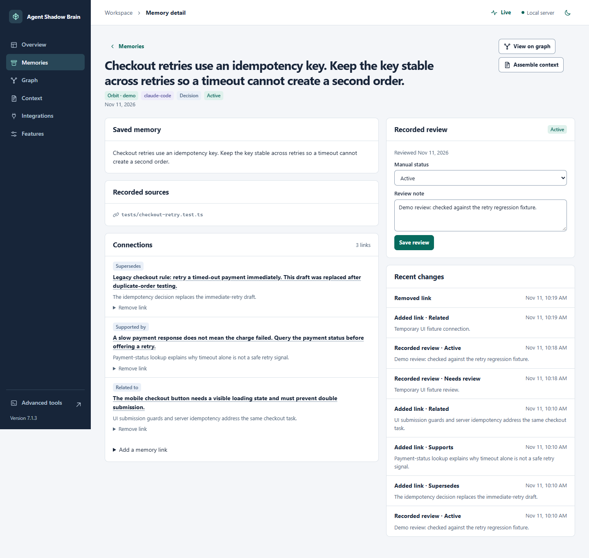

# Agent Shadow Brain

Agent Shadow Brain gives coding agents a shared local memory and a workspace you can inspect. Keep project decisions and sources together, review what is still useful, and build focused context for the next task. The live portal shows recorded sessions, tool calls, and host-reported task phases.



*Concept illustration of the memory and context flow.*

## Get started

Use Node.js 22.12+ within 22.x, Node.js 24.x, or Node.js 26+.

```bash
npm install -g @theihtisham/agent-shadow-brain@7.1.3
shadow-brain dash . --no-analysis
```

Run the dashboard command from your project directory. It opens the local workspace and skips background project analysis. Open the printed address if the browser does not start automatically. Use a second terminal for other commands while the dashboard is running.

## Watch activity as it happens

Open **Live** in the workspace, or add `/live` to its address. Select a session to inspect its event network, reported phases, and timeline. Charts summarize tool throughput, errors, and measured duration in the loaded window. Pause updates or reduce motion at any time.



*Running portal with scripted local MCP clients and synthetic data. Client labels in this demonstration do not prove native client installation or model connectivity.*

The standalone MCP service measures calls made through it. A connected host can explicitly report phases or its own tool events; these remain labeled **Host-reported**. Activity recording stores bounded metadata, not prompts, tool arguments, or memory content. The latest 500 events are retained, with visible notices for incomplete windows.

## Review the context your agent uses

- **Overview** shows project inventory, review states, recorded-source coverage, and recent activity.
- **Memories** lets you inspect content, sources, review history, and links. Mark entries active, archived, or contested.
- **Graph** connects projects, agents, and memories, including explicit support, contradiction, and replacement links.
- **Context** builds a copyable project pack and explains what was selected or excluded.
- **Integrations** shows client capabilities, project skill-file presence, and safe local diagnostics.
- **Features** controls context packs, cross-project context, automatic briefings, activity visibility, and activity recording separately.





*Workspace screenshots use synthetic memories. Recorded references and manual reviews help you check a claim; they do not establish its truth.*

Open **Advanced tools** or visit `/advanced` for the previous dashboard. [Workspace guide](docs/WORKSPACE.md)

## Build a context pack

```bash
shadow-brain context-pack "import retry behavior" --project . --token-budget 1200
shadow-brain features list
shadow-brain features set automaticBriefing off
```

A pack starts with the selected project's memories, excludes archived, contested, and superseded entries before ranking, collapses exact duplicates, and fits the rendered text to a size budget. Add `--json` to see selection reasons, sources, and recorded relationships. Cross-project context requires both an enabled feature setting and an explicit request. Token counts are estimates.

Automatic briefings use the same context selection. Cached briefings follow the current task, feature settings, and memory reviews. Inspect and change reviews in the workspace or with `shadow-brain curate --help`.

## Connect your coding client

```bash
shadow-brain clients config
shadow-brain mcp --stdio
```

`clients config` prints a launch configuration for the installed CLI. Add it to a compatible MCP client. The stdio service provides nine read-only memory and workflow tools plus an explicit `activity_report` tool for host reports. It runs without loading provider configuration. Configure your client to use `context_pack` for curated context.

Codex, Claude Code, OpenCode, and DeepSeek Harness have documented integration paths. DeepSeek Harness requires its MCP client and filesystem skill plugins. The Integrations view checks project skill files; loading them in a host is a separate step. [Connection and activity guide](docs/WORKSPACE.md)

## Add skills to a project

Six bundled skills cover workflow selection, implementation, debugging, review, research, and release. They help a client focus on the requested work, plan when useful, and verify the result.

```bash
shadow-brain skills list
shadow-brain skills install . --target codex
shadow-brain skills install . --target codex --apply
```

The first install command previews the files. The second applies the install and preserves your existing project instructions. Choose `claude-code`, `opencode`, `deepseek-harness`, or `portable` for other clients. Discovery depends on each client's skill support. [Skill integration guide](docs/WORKFLOW_INTEGRATION.md)

## Upgrade and reference

If you are upgrading from 6.x, back up `~/.shadow-brain/global.json` and stop older writers before using 7.x. The 7.x writers use a new lock protocol and keep memory schema version 1. [7.0 migration notes](docs/launch/RELEASE_NOTES_v7.0.0.md)

Version **7.1.3** is the requested release number for this upgrade, published after 7.2.0. Install it explicitly as shown above: semver-based update tools may otherwise prefer 7.2.0.

- [7.1.3 release notes](docs/launch/RELEASE_NOTES_v7.1.3.md)
- [Earlier CLI, MCP, seeding, and export guide](https://github.com/ihtishaam-dev/agent-shadow-brain/blob/v7.1.0/README.md)
- [Changelog](CHANGELOG.md) · [MIT license](LICENSE)
