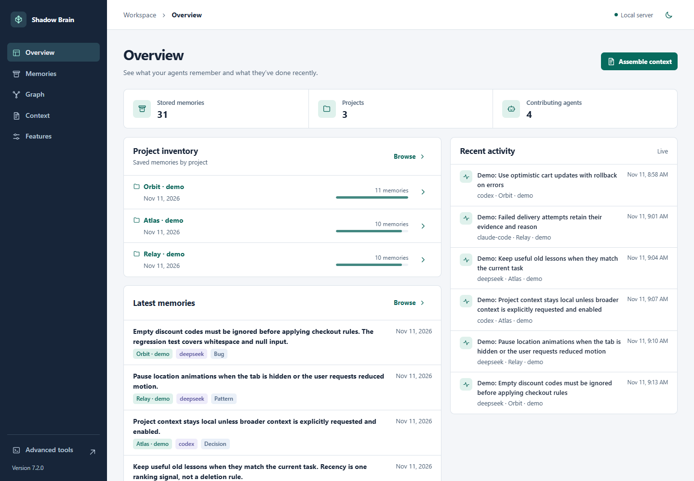
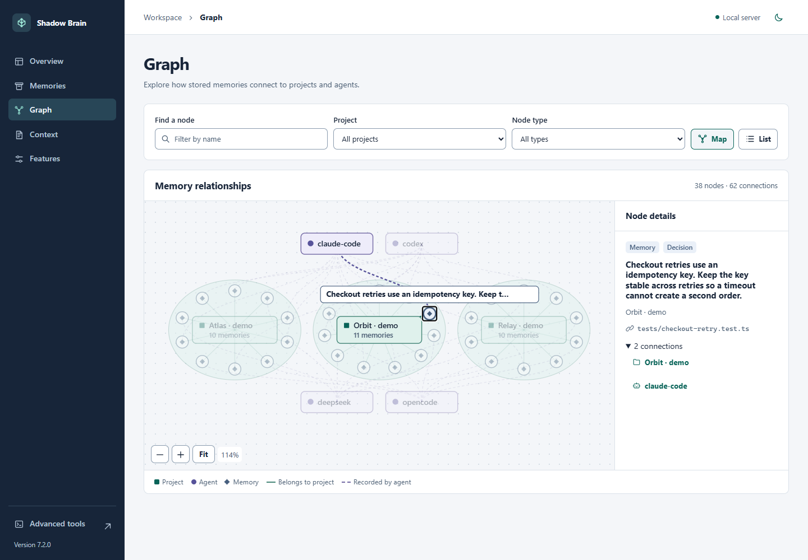

# Agent Shadow Brain

Agent Shadow Brain is a shared local memory store for coding agents. Save a project's decisions, lessons, and source references in one place, then recall the useful parts when you switch tools, hand off work, or start a fresh session.


*Concept illustration of the memory and context flow.*

## Get started

Use Node.js 22.12+ within 22.x, Node.js 24.x, or Node.js 26+.

```bash
npm install -g @theihtisham/agent-shadow-brain@7.2.0
shadow-brain dash . --no-analysis
```

Run the dashboard command from your project directory. It opens the local workspace and skips background project analysis. Open the printed address if the browser does not start automatically. Use a second terminal for other commands while the dashboard is running.

## Explore your memory

Version 7.2 opens a five-view workspace that runs locally and works offline.

- **Overview** shows memory and project counts, recent memories, and activity.
- **Memories** lets you search and filter saved entries by project, category, and agent.
- **Graph** shows which project each memory belongs to and which agent recorded it. Select a node to inspect it.
- **Context** builds a copyable pack for a project and task, with selection reasons and recorded sources.
- **Features** controls context packs, cross-project context, automatic briefings, and the dashboard activity feed.





*Screenshots from a running workspace populated with synthetic memories.*

Open **Advanced tools** or visit `/advanced` for the previous dashboard. [Workspace guide](docs/WORKSPACE.md)

## Build a context pack

```bash
shadow-brain context-pack "import retry behavior" --project . --token-budget 1200
shadow-brain features list
shadow-brain features set automaticBriefing off
```

A pack starts with the selected project's memories, collapses exact duplicates, and fits the rendered text to a size budget. Add `--json` to see why entries were selected or skipped. Cross-project context requires both an enabled feature setting and an explicit request. Token counts are estimates.

Automatic briefings use the same context selection. Cached briefings follow the current task and feature settings, so disabling briefings takes effect on the next request.

## Add skills to a project

Six bundled skills cover workflow selection, implementation, debugging, review, research, and release. They help a client focus on the requested work, plan when useful, and verify the result.

```bash
shadow-brain skills list
shadow-brain skills install . --target codex
shadow-brain skills install . --target codex --apply
```

The first install command previews the files. The second applies the install and preserves your existing project instructions. Choose `claude-code`, `opencode`, `deepseek-harness`, or `portable` for other clients. Discovery depends on each client's skill support. [Skill integration guide](docs/WORKFLOW_INTEGRATION.md)

## Upgrade and reference

If you are upgrading from 6.x, back up `~/.shadow-brain/global.json` and stop older writers before using 7.x. The 7.x writers use a new lock protocol and keep memory schema version 1. [7.0 migration notes](docs/launch/RELEASE_NOTES_v7.0.0.md)

- [7.2 release notes](docs/launch/RELEASE_NOTES_v7.2.0.md)
- [Earlier CLI, MCP, seeding, and export guide](https://github.com/ihtishaam-dev/agent-shadow-brain/blob/v7.1.0/README.md)
- [Changelog](CHANGELOG.md) · [MIT license](LICENSE)
