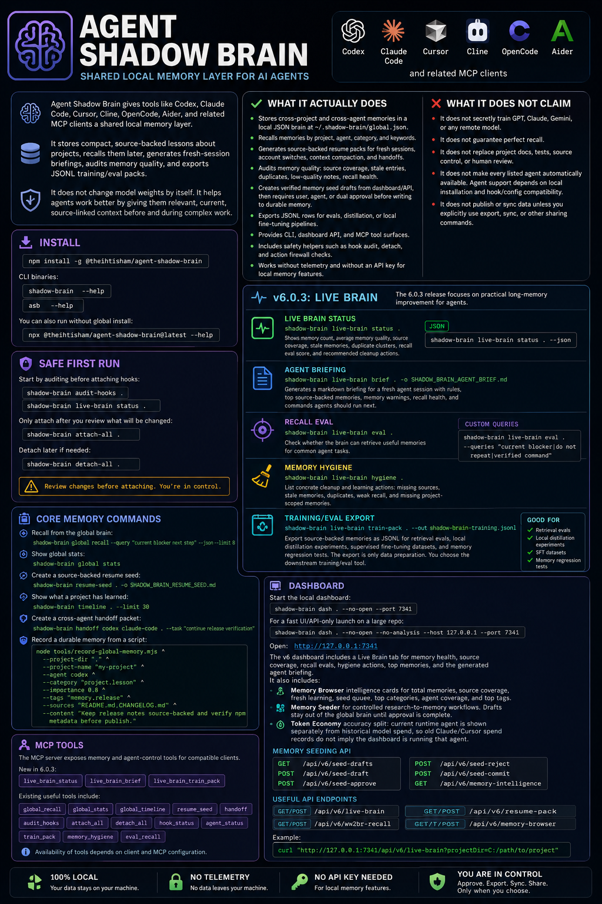

# Agent Shadow Brain

Local-first memory and coordination for AI coding agents.

Version: 6.0.3

<p align="center">
  
</p>
<a href="https://trendshift.io/repositories/20881" target="_blank"></a>
<p align="center">
  
</p>

Agent Shadow Brain gives tools like Codex, Claude Code, Cursor, Cline, OpenCode, Aider, and related MCP clients a shared local memory layer. It stores compact, source-backed lessons about projects, recalls them later, generates fresh-session briefings, audits memory quality, and exports JSONL training/eval packs.

It does not change model weights by itself. It helps agents work better by giving them relevant, current, source-linked context before and during complex work.

## What It Actually Does

- Stores cross-project and cross-agent memories in a local JSON brain at `~/.shadow-brain/global.json`.
- Recalls memories by project, agent, category, and keywords.
- Generates source-backed resume packs for fresh sessions, account switches, context compaction, and handoffs.
- Audits memory quality: source coverage, stale entries, duplicates, low-quality notes, recall health.
- Creates verified memory seed drafts from dashboard/API, then requires user, agent, or dual approval before writing to durable memory.
- Exports JSONL rows for evals, distillation, or local fine-tuning pipelines.
- Provides CLI, dashboard API, and MCP tool surfaces.
- Includes safety helpers such as hook audit, detach, and action firewall checks.
- Works without telemetry and without an API key for local memory features.

## What It Does Not Claim

- It does not secretly train GPT, Claude, Gemini, or any remote model.
- It does not guarantee perfect recall.
- It does not replace project docs, tests, source control, or human review.
- It does not make every listed agent automatically available. Agent support depends on local installation and hook/config compatibility.
- It does not publish or sync data unless you explicitly use export, sync, or other sharing commands.

## Install

```bash
npm install -g @theihtisham/agent-shadow-brain
```

CLI binaries:

```bash
shadow-brain --help
asb --help
```

You can also run without global install:

```bash
npx @theihtisham/agent-shadow-brain@latest --help
```

## Safe First Run

Start by auditing before attaching hooks:

```bash
shadow-brain audit-hooks .
shadow-brain live-brain status .
```

Only attach after you review what will be changed:

```bash
shadow-brain attach-all .
```

Detach later if needed:

```bash
shadow-brain detach-all .
```

## v6.0.3: Live Brain

The 6.0.3 release focuses on practical long-memory improvement for agents.

### Live Brain Status

```bash
shadow-brain live-brain status .
```

Shows:

- memory count
- average memory quality
- source coverage
- stale memories
- duplicate clusters
- recall eval score
- recommended cleanup actions

JSON output:

```bash
shadow-brain live-brain status . --json
```

### Agent Briefing

Generate a markdown briefing for a fresh agent session:

```bash
shadow-brain live-brain brief . -o SHADOW_BRAIN_AGENT_BRIEF.md
```

The briefing includes:

- rules for agents
- top source-backed memories
- memory warnings
- recall health
- commands agents should run next

### Recall Eval

Check whether the brain can retrieve useful memories for common agent tasks:

```bash
shadow-brain live-brain eval .
```

Custom eval queries use pipe separators:

```bash
shadow-brain live-brain eval . --queries "current blocker|do not repeat|verified command"
```

### Memory Hygiene

List concrete cleanup and learning actions:

```bash
shadow-brain live-brain hygiene .
```

This highlights missing sources, stale memories, duplicates, weak recall, and missing project-scoped memories.

### Training/Eval Export

Export source-backed memories as JSONL:

```bash
shadow-brain live-brain train-pack . --out shadow-brain-training.jsonl
```

This is useful for:

- retrieval evals
- local distillation experiments
- supervised fine-tuning datasets
- memory regression tests

The export is only data preparation. You choose the downstream training/eval tool.

## Core Memory Commands

Recall from the global brain:

```bash
shadow-brain global recall --query "current blocker next step" --json --limit 8
```

Show global stats:

```bash
shadow-brain global stats
```

Create a source-backed resume seed:

```bash
shadow-brain resume-seed . -o SHADOW_BRAIN_RESUME_SEED.md
```

Show what a project has learned:

```bash
shadow-brain timeline . --limit 30
```

Create a cross-agent handoff packet:

```bash
shadow-brain handoff codex claude-code . --task "continue release verification"
```

Record a durable memory from a script:

```bash
node tools/record-global-memory.mjs ^
  --project-dir "." ^
  --project-name "my-project" ^
  --agent codex ^
  --category "project.lesson" ^
  --importance 0.8 ^
  --tags "memory,release" ^
  --sources "README.md,CHANGELOG.md" ^
  --content "Keep release notes source-backed and verify npm metadata before publish."
```

## Dashboard

Start the local dashboard:

```bash
shadow-brain dash . --no-open --port 7341
```

For a fast UI/API-only launch on a large repo:

```bash
shadow-brain dash . --no-open --no-analysis --host 127.0.0.1 --port 7341
```

Open:

```text
http://127.0.0.1:7341
```

The v6 dashboard includes a **Live Brain** tab for memory health, source coverage, recall evals, hygiene actions, top memories, and the generated agent briefing.

It also includes:

- **Memory Browser intelligence cards** for total memories, source coverage, fresh learning, seed queue, top categories, agent coverage, and top tags.
- **Memory Seeder** for controlled research-to-memory workflows. Drafts stay out of the global brain until approval is complete.
- **Token Economy accuracy split**: current runtime agent is shown separately from historical model spend, so old Claude/Cursor spend records do not imply the dashboard is running that agent.

Memory seeding API:

```text
GET  /api/v6/seed-drafts
POST /api/v6/seed-draft
POST /api/v6/seed-approve
POST /api/v6/seed-reject
POST /api/v6/seed-commit
GET  /api/v6/memory-intelligence
```

Useful API endpoints:

```text
GET/POST /api/v6/live-brain
GET/POST /api/v6/resume-pack
GET/POST /api/v6/ww2br-recall
GET/POST /api/v6/memory-browser
```

Example:

```bash
curl "http://127.0.0.1:7341/api/v6/live-brain?projectDir=C:/path/to/project"
```

## MCP Tools

The MCP server exposes memory and agent-control tools for compatible clients.

New in 6.0.3:

- `live_brain_status`
- `live_brain_brief`
- `live_brain_train_pack`

Existing useful tools include:

- `global_recall`
- `global_stats`
- `global_timeline`
- `subconscious_inject`
- `agent_handoff`
- `firewall_check`

Start MCP from the dashboard API or existing CLI/server integration, depending on your setup.

## How Agents Should Use It

Recommended workflow for complex work:

1. Run `shadow-brain live-brain status <project>`.
2. Generate or read a live briefing.
3. Verify current project docs and source files.
4. Work normally.
5. Record only durable, source-backed lessons after proof.
6. Run recall evals when memory quality starts to drift.

Good memories are short, action-oriented, and source-backed:

```text
[lesson:release-readme-v1] Before publishing, verify package.json version, package-lock root version, README install commands, build output, and npm pack contents.
Sources: package.json; package-lock.json; README.md
Tags: release,npm,verification
```

Bad memories are vague:

```text
Make project better.
```

## Local Data

Default global brain:

```text
~/.shadow-brain/global.json
```

Project-local generated files may include:

```text
SHADOW_BRAIN_AGENT_BRIEF.md
SHADOW_BRAIN_RESUME_SEED.md
shadow-brain-training.jsonl
```

Do not store secrets, API keys, passwords, private keys, or raw credentials in memory content, metadata, tags, prompts, reports, or exported training data.

## Development

```bash
npm install
npm run build
npm test
```

Focused tests:

```bash
npx vitest run tests/brain/live-brain.test.ts tests/brain/context-continuity.test.ts
```

On Windows PowerShell, if execution policy blocks `npm.ps1`, use:

```powershell
npm.cmd run build
npx.cmd vitest run tests\brain\live-brain.test.ts
```

## Release Checklist

For a 6.0.3 release:

```bash
npm run build
npm test
npm pack --dry-run
```

Then publish only after verifying the package contents:

```bash
npm publish --access public
```

GitHub release should include:

- this README
- `CHANGELOG.md`
- `docs/launch/RELEASE_NOTES_v6.0.3.md`
- `docs/launch/RELEASE_CHECKLIST_v6.0.3.md`
- build/test output
- npm package dry-run output

## License

MIT
