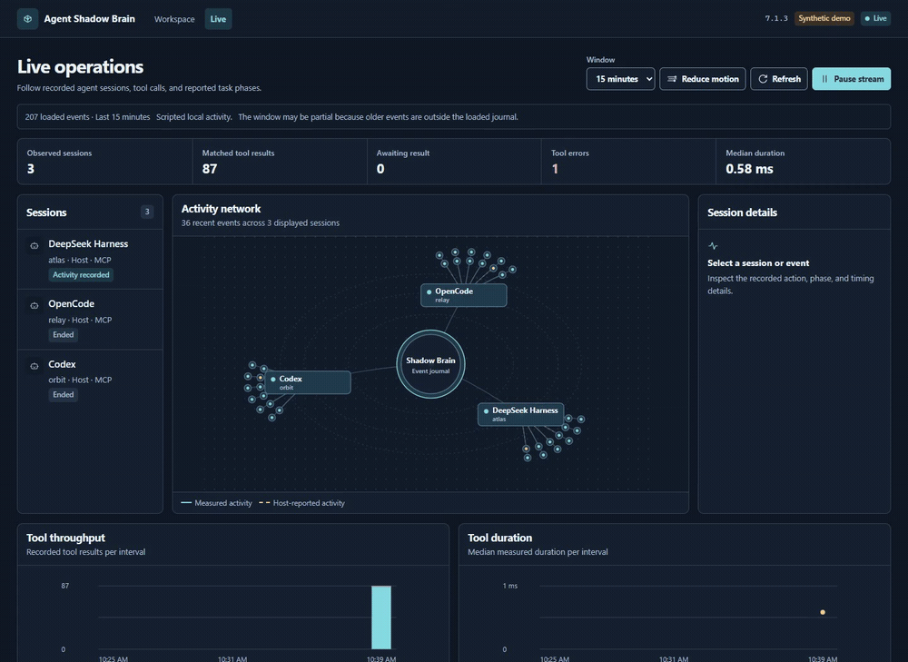

<h1 align="center">Agent Shadow Brain</h1>

<p align="center">Local memory, scoped task context, and live activity for coding agents.</p>

<p align="center">
  <a href="https://www.npmjs.com/package/@theihtisham/agent-shadow-brain"></a>
  <a href="https://www.npmjs.com/package/@theihtisham/agent-shadow-brain"></a>
  <a href="docs/STATS.md"></a>
  <a href="https://github.com/ihtishaam-dev/agent-shadow-brain/actions/workflows/ci.yml"></a>
  <a href="LICENSE"></a>
  <a href="https://github.com/ihtishaam-dev/agent-shadow-brain/stargazers"></a>
  <a href="https://github.com/trending?since=daily"></a>
</p>

<p align="center">
  <a href="#quickstart">Quickstart</a> ·
  <a href="#connect-a-client">Connect a client</a> ·
  <a href="docs/README.md">Documentation</a> ·
  <a href="https://github.com/ihtishaam-dev/agent-shadow-brain/releases/tag/v7.1.3">7.1.3 release</a>
</p>

<p align="center">
  <a href="https://github.com/ihtishaam-dev/agent-shadow-brain/releases/download/v7.1.3/7.1.3-live-demo.mp4">
    
  </a>
</p>

<p align="center"><em>Recorded with scripted local MCP clients and synthetic project data.</em> <a href="https://github.com/ihtishaam-dev/agent-shadow-brain/releases/download/v7.1.3/7.1.3-live-demo.mp4">Watch the MP4</a></p>

## What you can do

| Workflow | What you can inspect or change |
| --- | --- |
| **Review project memory** | Search saved decisions and lessons, inspect recorded sources, and record reviews or typed relationships in the memory graph. |
| **Build task context** | Assemble a project-scoped pack within a size budget. See why each memory was included or skipped before handing the pack to an agent. |
| **Follow live operations** | Inspect measured MCP calls, explicitly reported task phases, and the event timeline. Pause updates or reduce motion. |
| **Give agents focused workflows** | Install six project skills for workflow selection, implementation, debugging, review, research, and release. |
| **Check integrations** | See supported client capabilities, project skill-file presence, storage health, and a copyable diagnostic report. |

The workspace connects these views. Open a memory from a context pack or graph edge to see the saved content, its recorded references, and the review history. You can control context assembly, cross-project context, session briefings, live updates, and activity recording separately. [Screenshot gallery](docs/SHOWCASE.md) · [Workspace guide](docs/WORKSPACE.md)

<details>
<summary>How it fits together</summary>


</details>

## Quickstart

Use Node.js 22.12 or later in the 22.x line, 24.x, or 26 and later. Run the dashboard command from your project directory.

```bash
npm install -g @theihtisham/agent-shadow-brain@7.1.3
shadow-brain --version
shadow-brain dash . --no-analysis
```

The dashboard prints its local address. Open **Memories** to inspect saved records, **Context** to assemble a pack, or **Live** to follow recorded activity. The CLI also assembles a pack from the current project.

```bash
shadow-brain context-pack "import retry behavior" --project . --token-budget 1200 --json
```

Pin `7.1.3` for this release because npm’s `latest` tag and semantic version order can differ. The quickstart also includes the verified GitHub tarball and a first-memory example. [Full quickstart](docs/QUICKSTART.md)

## Connect a client

Print the standalone MCP launch configuration, then add it to your client’s MCP settings.

```bash
shadow-brain clients config
```

The launch command is `shadow-brain mcp --stdio`. It serves memory, context, and workflow tools locally without loading model-provider configuration. Use `context_pack` for curated project context and `activity_report` to explicitly record host activity. The live journal keeps the latest 500 events with bounded labels and timings. [MCP and activity guide](docs/WORKSPACE.md#integrate-with-a-client)

| Client | Skill target | Project skill directory |
| --- | --- | --- |
| Codex | `codex` | `.agents/skills/` |
| Claude Code | `claude-code` | `.claude/skills/` |
| OpenCode | `opencode` | `.opencode/skills/` |
| DeepSeek Harness | `deepseek-harness` | `.dsh/skills/` |
| Other compatible clients | `portable` | `.agents/skills/` |

Preview the skill files and apply the installation for your chosen target.

```bash
shadow-brain skills list
shadow-brain skills install . --target codex
shadow-brain skills install . --target codex --apply
```

Skill discovery and MCP connections depend on the client’s settings. DeepSeek Harness needs its filesystem skill and MCP client plugins enabled. The dashboard’s Integrations view checks managed project files. [Client setup guide](docs/INTEGRATIONS.md)

## Documentation

| Guide | Covers |
| --- | --- |
| [Start here](docs/QUICKSTART.md) | Installation, first memory, dashboard, and MCP setup |
| [Workspace](docs/WORKSPACE.md) | Reviews, relationships, context limits, activity journal, and local API |
| [Integrations](docs/INTEGRATIONS.md) | MCP setup and project skill layouts by client |
| [Workflow skills](docs/WORKFLOW_INTEGRATION.md) | Installation layouts, previews, and the six bundled skills |
| [Showcase](docs/SHOWCASE.md) | Annotated gallery of the workspace and live portal |
| [Troubleshooting](docs/TROUBLESHOOTING.md) | Startup, memory, context, and integration checks |
| [7.1.3 release notes](docs/launch/RELEASE_NOTES_v7.1.3.md) | Upgrade steps, curation changes, and live operations |
| [Download statistics](docs/STATS.md) | npm download counts and their reporting window |

[Documentation index](docs/README.md) · [Changelog](CHANGELOG.md) · [Report an issue](https://github.com/ihtishaam-dev/agent-shadow-brain/issues)

## Package details

| Item | 7.1.3 release |
| --- | --- |
| Package | [`@theihtisham/agent-shadow-brain`](https://www.npmjs.com/package/@theihtisham/agent-shadow-brain) |
| CLI | `shadow-brain` or `asb` |
| Interfaces | Local web workspace, CLI, MCP stdio, and JavaScript/TypeScript library |
| Node.js | `^22.12.0 \|\| ^24.0.0 \|\| >=26.0.0` |
| Tarball | 3,443,588 bytes packed, about 8.7 MB unpacked, 729 files |
| License | [MIT](LICENSE) |

[Verified tarball](https://github.com/ihtishaam-dev/agent-shadow-brain/releases/download/v7.1.3/theihtisham-agent-shadow-brain-7.1.3.tgz) · [Package verification report](https://github.com/ihtishaam-dev/agent-shadow-brain/releases/download/v7.1.3/PACKAGE_VERIFICATION_v7.1.3.json)

## Maintainers

[@ihtishaam-dev](https://github.com/ihtishaam-dev) · [@theihtishaam](https://github.com/theihtishaam)
