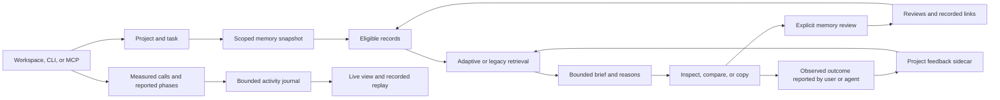

# Component guide

Agent Shadow Brain 7.1.4 shares a project memory store across the workspace, CLI, and standalone MCP service. The project, feature settings, and annotation snapshot determine which records are eligible for a task brief.

## Shared paths

| Component | Responsibility | Source |
| --- | --- | --- |
| Global memory | Loads schema-1 records, preserves queued operations on refresh, and handles storage health and durable commits. | [GlobalBrain](../src/brain/global-brain.ts) |
| Project-local workspace | Opens a separate store for one selected project and saves explicitly supplied knowledge there. | [Project workspace](../src/dashboard/project-workspace.ts) · [Project memory](../src/brain/project-memory.ts) |
| Project Kit | Reads bounded marker and manifest evidence, previews a task-specific skill, and applies it with a matching plan hash and ownership receipt. | [Project Kit](../src/brain/project-kit.ts) · [Project inspection](../src/brain/project-kit-inspection.ts) |
| Reviews and links | Stores review state, relations, and revisioned history separately from original content. | [Memory annotations](../src/brain/memory-annotations.ts) |
| Retrieval and context | Ranks eligible records, groups duplicates, selects passages, applies the rendered budget, and explains the result. Existing recall remains available. | [Context assembly](../src/brain/context-assembly.ts) · [Adaptive retrieval](../src/brain/context-retrieval.ts) |
| Project task feedback | Keeps a bounded, revisioned record of reported outcomes and adjusts eligible direct adaptive matches on similar tasks in that project. | [Project feedback](../src/brain/project-feedback.ts) · [Reported outcome guide](LEARNING.md) |
| Evidence inspection | Returns saved text and recorded references with review and relation details. Health adds bounded review hints. | [Memory inspection](../src/brain/memory-inspection.ts) · [Reference normalization](../src/brain/memory-sources.ts) |
| Workspace | Serves overview, health, memory, graph, context, comparison, integrations, and settings. The web interface consumes the shared local API. | [Workspace API](../src/dashboard/workspace-api.ts) · [Workspace UI](../src/dashboard/workspace-html.ts) |
| MCP | Serves 12 tools in the normal memory profile and 17 when launched against a Project Kit store. Both expose local resources and user-selected prompts to compatible hosts. | [Stdio transport](../src/brain/mcp-stdio.ts) · [Server](../src/brain/mcp-server.ts) · [Resources and prompts](../src/brain/memory-mcp-content.ts) |
| CLI and recipes | Provides the same context, health, and curation commands. Client recipes print a launch entry for the current installation. | [Context CLI](../src/context-cli.ts) · [Curation CLI](../src/curation-cli.ts) · [Client recipes](../src/brain/client-config.ts) |
| Workflow and skills | Routes advisory tasks and exposes six focused skill files for supported project layouts. | [Task workflow](../src/brain/task-workflow.ts) · [Skill installer](../src/brain/workflow-skills.ts) · [Skills](../skills/) |
| Live journal | Records bounded metadata for measured tool activity and explicitly reported host phases. Readers receive cursors and gap information. | [Activity journal](../src/brain/activity-journal.ts) · [Activity reporting](../src/brain/activity-reporting.ts) |
| Live operations | Shows selected sessions and events, measured timing, and replay over loaded journal records. | [Live workspace](../src/dashboard/live-workspace-html.ts) |
| Runtime switches | Persists the five feature controls with revision checks. Profile and expansion selection belong to individual requests. The project feedback sidecar holds its own reversible influence switch. | [Feature settings](../src/brain/feature-settings.ts) · [Project feedback](../src/brain/project-feedback.ts) |
| Synthetic tour | Runs the workspace and recorded sample activity on loopback with a temporary store and scripted MCP calls. | [Demo workspace](../src/dashboard/demo-workspace.ts) |
| Package entry | Publishes the library exports and the `shadow-brain` and `asb` commands. | [Library exports](../src/index.ts) · [CLI entry](../src/cli.ts) · [Package manifest](../package.json) |

The memory store and curation use separate schema-1 files. Project feedback is stored separately in the selected project's `.shadow-brain/memory-feedback.json`. Review and link operations preserve the original text. Assembly and inspection read the local view without committing pending writes. The local core treats each source reference as recorded text. Verify claims against the project evidence.

## Retained components

The previous dashboard is available at `/advanced` on the normal dashboard server. Other components remain available through their existing CLI, exports, integrations, or source files. Some have separate stores, model settings, runtimes, or operating requirements. The matrix identifies where to start inspecting them. Use the individual module and its tests to establish behavior in your configuration.

| Area | Existing components | Where to start |
| --- | --- | --- |
| Project observation and analysis | File and Git watchers, orchestrator, project context, AST and semantic analysis, project presets, code metrics, code age, accessibility, and health scoring | [Watchers](../src/watchers/) · [Orchestrator](../src/brain/orchestrator.ts) · [Analyzer](../src/brain/analyzer.ts) |
| Dependency and code graphs | Dependency and knowledge graphs, influence maps, causal chains, graph walker, memory graph, and code similarity | [Dependency graph](../src/brain/dependency-graph.ts) · [Knowledge graph](../src/brain/knowledge-graph.ts) · [Memory graph](../src/brain/memory-graph.ts) |
| Review and diagnostics | API and environment analysis, dead-code detection, mutation advice, i18n, license compliance, security checks, configuration drift, PR review, and fix suggestions | [API contracts](../src/brain/api-contract-analyzer.ts) · [Security audit](../src/brain/security-audit.ts) · [Smart fix](../src/brain/smart-fix.ts) |
| Model and provider integrations | Model registry, client-specific adapters, local LLM support, multimodal helpers, provider-driven analyzers, and LSP integration | [Adapters](../src/adapters/) · [LLM client](../src/brain/llm-client.ts) · [Local LLM](../src/brain/local-llm.ts) · [LSP server](../src/brain/lsp-server.ts) |
| Other recall paths | Associative context recall, hierarchical and tiered memory, working memory, pattern memory, embeddings, reranking, query expansion, and caches | [Context recall](../src/brain/context-recall.ts) · [Embeddings](../src/brain/embeddings-v2.ts) · [Recall cache](../src/brain/brain-recall-cache.ts) |
| Continuity and portability | Session briefing, older handoff and resume commands, Live Brain reporting, branch memory, markdown import/export, backups, exchanges, and time capsules | [Session briefing](../src/brain/subconscious.ts) · [Agent handoff](../src/brain/agent-handoff.ts) · [Continuity](../src/brain/context-continuity.ts) · [Portability](../src/brain/brain-portability.ts) |
| Team and delegation | Team mode and sync, cross-agent protocols, consensus, swarm concepts, delegation helpers, subagent context, and reputation tracking | [Team mode](../src/brain/team-mode.ts) · [Subagent bridge](../src/brain/subagent-bridge.ts) · [Cross-agent protocol](../src/brain/cross-agent-protocol.ts) |
| Learning and experimentation | Learning engine, consolidation, active learning, forgetting curve, dream and prediction modules, fine-tuning tools, and routing experiments | [Learning engine](../src/brain/learning-engine.ts) · [Dream engine](../src/brain/dream-engine.ts) · [Fine-tuning tools](../tools/lora-pipeline/) |
| Operational and policy helpers | Session hooks, tracing, cost reporting, plugin system, calibration, firewall, encryption, formal-verification bridge, and quarantine | [Session hooks](../src/brain/session-hooks.ts) · [Tracing](../src/brain/otel-lite.ts) · [Firewall](../src/brain/agent-firewall.ts) · [Plugin system](../src/brain/plugin-system.ts) |
| Visual, audio, and creative tools | Previous dashboard, standalone replay export, cinematic and ASCII views, 3D graph export, sonification, voice, and creative cards | [Previous dashboard](../src/dashboard/v6-dashboard-html.ts) · [Replay export](../src/brain/brain-replay.ts) · [3D graph](../src/brain/brain-3d.ts) · [Sonification](../src/brain/brain-sonification.ts) |

The previous handoff and continuity commands have their own selection and rendering. The automatic session briefing uses the existing context behavior. The new Context Lab and user-selected MCP prompts explicitly request adaptive retrieval. The new Live replay plays loaded journal events. The older replay export remains a separate command.

The detailed [source inventory](launch/COMPONENT_MAP_v7.1.4.md#source-inventory) lists retained modules. See [historical versions](versions/README.md) for earlier release surfaces and the [evaluation report](evaluation/CONTEXT_EVALUATION_v7.1.4.md) for the tested scope of adaptive context.
