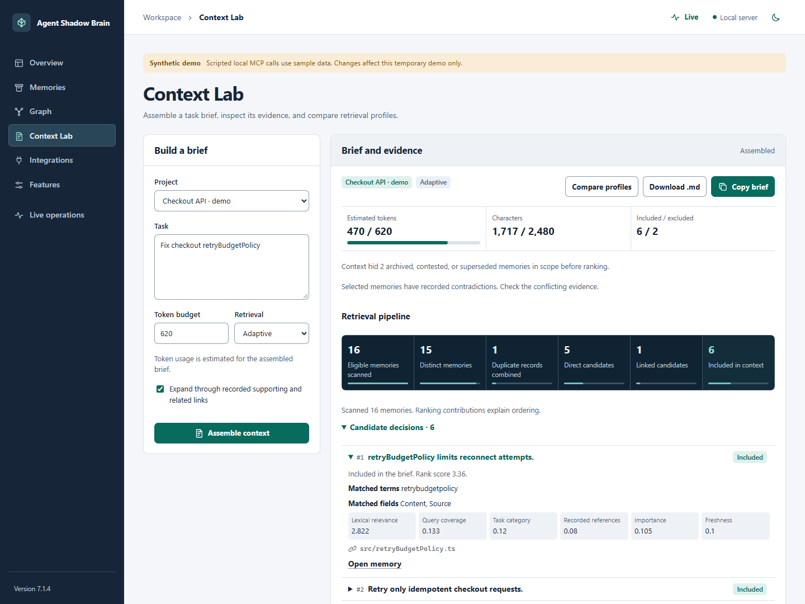

# Context Lab

Build a brief from saved project memory, inspect the records and references it contains, and compare adaptive and legacy retrieval before sharing it with another coding agent.

## Open the sample workspace

```bash
shadow-brain demo workspace --port 0 --no-activity
```

Open the printed **Workspace** address and select **Context Lab**. The demo seeds two synthetic projects and an initial event journal. Port `0` selects an available loopback port, and `--no-activity` keeps the initial journal snapshot in place. Reviews and settings changed here belong to the temporary demo. Press **Ctrl+C** in its terminal to stop and clean it up.

For the existing shared memory store, run `shadow-brain dash . --no-analysis` and choose a project with saved memories. To work with files and knowledge stored inside one project, run `shadow-brain project workspace . --port 0` instead. In that workspace, open **Project Kit**, save a knowledge record, and build a brief for the same project. Saved knowledge remains after the server closes. [Quickstart](QUICKSTART.md) · [Project Kit](PROJECT_KIT.md)

## Assemble and inspect a brief

1. Choose **Checkout API · demo**, enter `Fix checkout retryBudgetPolicy`, and leave **Retrieval** on **Adaptive**. Use a budget of 2,000 for the first run.
2. Keep **Expand through recorded supporting and related links** selected to include eligible one-hop neighbors. Select **Assemble context**.
3. In **Retrieval pipeline**, compare eligible records scanned, distinct records, direct matches, linked candidates, and entries included in the brief. Open **Candidate decisions** to see the matched terms and fields, rank contributions, recorded references, and any link path.
4. Open a record from **Included memories**, **Excluded memories**, or a candidate. Read its full saved content and review history, then follow the displayed reference to confirm important facts in your own project.
5. Select **Compare profiles** to run both profiles on the same project, task, and requested budget. Check the shared records and the IDs unique to each profile. A different result can reflect matching, duplicate handling, link expansion, passage length, or the token estimate.
6. When the selected evidence fits the task, use **Copy brief** or **Download .md**. If the form or curation changes, assemble again before copying.



The screenshot shows the shipped workspace using synthetic checkout records. [Full showcase](SHOWCASE.md)

## Review a record and its links

- From **Overview**, select a project scope and use **Attention queue** to find contested records, contradictions, unavailable relation endpoints, duplicates, missing references, and older active records. The report scans up to 5,000 recent records within the selected scope. The queue is a bounded review list. Age starts at 90 days and serves as a review hint.
- From **Memories**, open the record, choose a **Manual status**, and add a note if it explains the decision. **Active** keeps a record eligible. **Archived** and **Contested** keep it out of assembled context. **Superseded** comes from a recorded replacement link. For a replacement, point `supersedes` from the new record to the old one.
- To inspect the relationship, open **Graph**, select the memory or edge, and use **Focus recorded links** for the selected memory. Membership and recording-agent edges show where a memory came from. The typed edges represent explicit records, and their endpoints open in the inspector.
- Return to **Context Lab** and rebuild the same task to see which records remain eligible. A recorded contradiction is displayed as a caution. A missing replacement leaves its superseded predecessor excluded until the relation is removed.

Review and link changes use revisions. If another update arrives first, refresh the record and apply the change using the current revision. [Workspace guide](WORKSPACE.md)

## How the profiles work

| Behavior | Adaptive | Legacy |
| --- | --- | --- |
| Matching | Unicode-aware lexical terms, whole code identifier variants, filenames, and recorded source or tag fields | Existing weighted substring matching |
| Ranking | Scoped term frequency and rarity, task category, phrase and path signals, importance, freshness, and reference presence | Existing recall score blends matching, importance, age, usage, and other-agent copies |
| Duplicates | Exact normalized text grouped before the distinct-candidate cap, with originating IDs for retained references | Candidate cap applied before duplicate collapse |
| Excerpt | Shows a passage around a matched content term and can shorten it to fit the budget | Shows the beginning of the record within the existing excerpt limit |
| Recorded links | Optional one-hop expansion through eligible `supports` and `related` links | Shows recorded relations on selected records |
| Explanation | Bounded candidate decisions, rank contributions, matched fields, and expansion paths | Existing reasons and exclusions |
| Project task feedback | The project-local workspace can adjust existing direct matches using reported outcomes from similar tasks | Existing ranking |

Both profiles use the requested project scope and apply curation. Broader retrieval needs **Cross-project context** enabled under Features and an explicit choice for the request. A recorded relation never broadens a project's scope.

Adaptive diagnostics show up to 200 candidate records, with up to four source references per candidate. Matching reads the first 128,000 characters of exceptionally long saved records and reports when that limit applies. Expansion considers up to two eligible neighbors per seed and up to 16 overall. The rendered character cap includes the heading, excerpt, references, and link cautions. Token estimates depend on the profile and can differ from the receiving model's tokenizer.

Scores explain ordering. References record what a memory author cited. The assembler uses saved text and metadata without opening the referenced files or URLs. Treat the copied brief as reference material and verify important facts before relying on it.

## Check a reported outcome

1. Use a memory in actual project work and check the result. In the project-local workspace, open **Project Kit → Memory outcomes** and record the memory, task, rating, and reason. Add a reference if it helps someone repeat the check.
2. Reassemble a similar task in Context Lab. If the record is an eligible direct lexical match, its candidate details can show a signed **Project task feedback** contribution and reporter attribution. The JSON diagnostics include the contributing report IDs. Similarity and reporter type affect the contribution. A user's report takes precedence when an agent reported on the same task.
3. Pause feedback influence and rebuild to inspect the baseline ordering. Pausing keeps the saved reports available. Remove an individual report when it should no longer participate.

The contribution adjusts ranking within a small range. Eligibility still comes from the current query, project scope, and curation. [Reported outcome guide](LEARNING.md)

## Use the CLI or MCP

```bash
shadow-brain context-pack "Trace retryBudgetPolicy" --project . --profile adaptive --token-budget 1200 --json
shadow-brain context-pack "Trace retryBudgetPolicy" --project . --profile adaptive --no-related
shadow-brain memory-health --project . --limit 20
```

For an existing project ID, substitute `--project-id <id>` for `--project .`. CLI, SDK, and MCP callers that omit the profile use **Legacy**. The workspace selects **Adaptive** initially. The adaptive CLI option `--no-related` is equivalent to `expandRelated: false` in a context request.

Through MCP, call `context_pack` with `projectId`, `query`, `profile: "adaptive"`, and an optional `tokenBudget`. Use `memory_inspect` with `projectId` and `memoryId` for a bounded saved record, or `memory_health` with `projectId` to list review hints. A host with prompt support can expose `shadow-task` and `shadow-handoff` as user-selected templates. Generate a project-local client recipe with `shadow-brain project config . --target codex` to use the project's knowledge and feedback with the same client. [Client integration guide](INTEGRATIONS.md)

## See the paired results

Adaptive passed all 14 author-generated diagnostic cases and Legacy passed 6. Both passed the no-evidence control, the tested project-scope checks, and rendered-budget checks. The cases target specific behaviors such as exact Java matching, late excerpts, duplicate pressure, and one-hop links. [Evaluation report](evaluation/CONTEXT_EVALUATION_v7.1.4.md) · [Raw results](evaluation/CONTEXT_EVALUATION_v7.1.4.json)

Reproduce the paired cases from a source checkout with `npm run build` followed by `npm run test:context-eval`.
