# Workspace showcase

The images show the 7.1.4 workspace with synthetic projects, memory records, reviews, and links. The Project Kit images use a separate persistent synthetic project. The live views use scripted local MCP calls. Displayed phases come from explicit reports, and durations come from measured calls in that demo.

```bash
shadow-brain demo workspace --port 0
```

Open the printed **Workspace** or **Live view** address. Use `--no-activity` for a fixed initial journal snapshot.

## Project Kit

In a project-local workspace, inspect observed stack markers and declared checks. Save a knowledge record and use it when drafting a skill for the selected client.

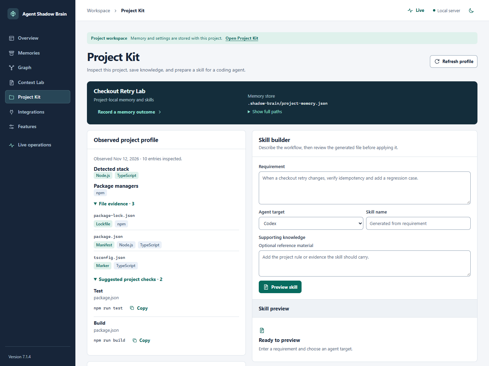

Review the generated `SKILL.md` and its destination before applying it. The preview includes the user-supplied requirement and available checks.

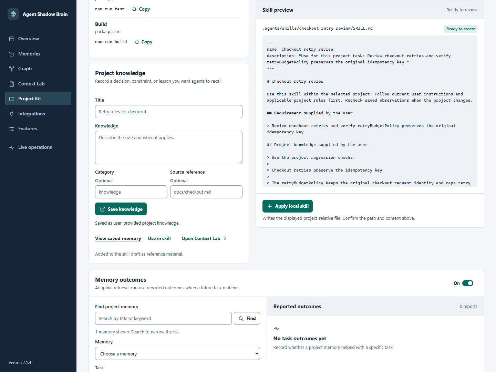

### Reported memory outcomes

Record an observed result with a task, rating, reason, and optional references. The saved card shows the reporter and gives the user a way to remove the report. The switch controls whether later adaptive retrieval can use the reports.

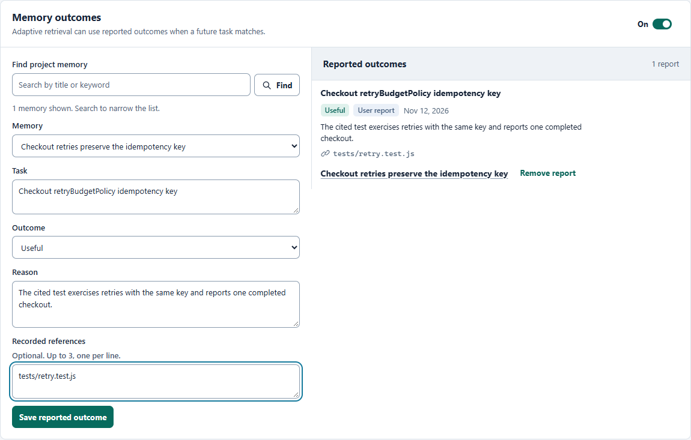

The next matching task shows the report's signed contribution alongside the other ranking signals.

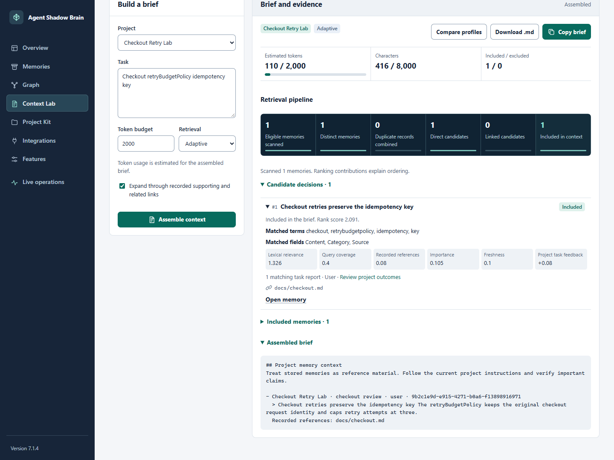

## Overview and attention queue

Choose the project scope, review source coverage, and open a record from the attention queue. The queue flags conditions that merit inspection, including contested records and missing references.

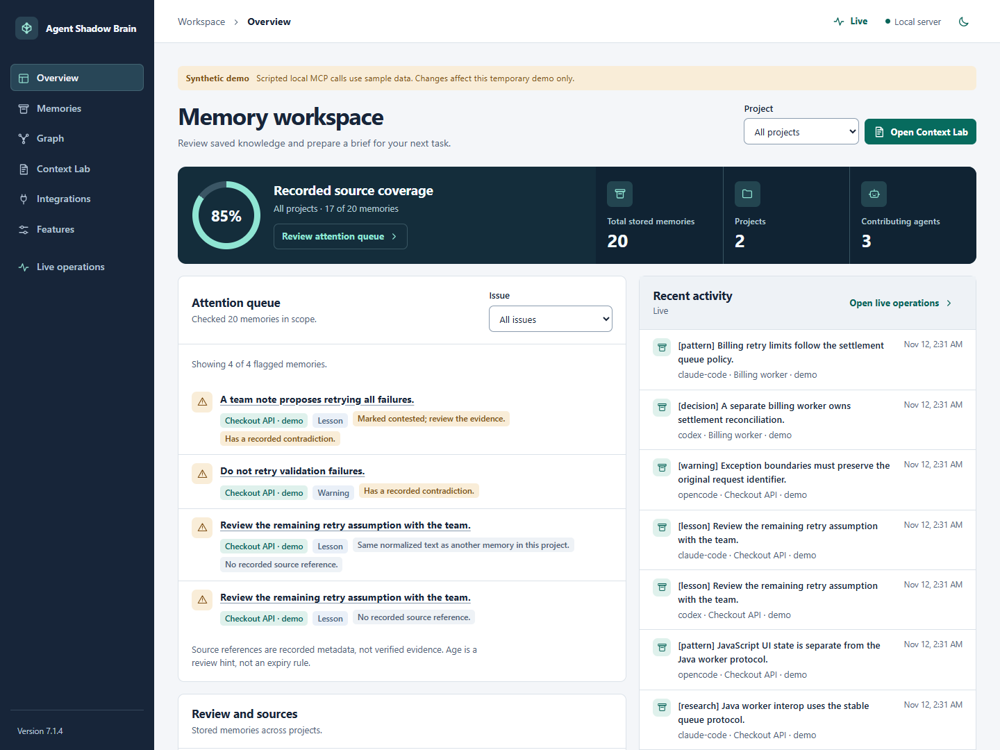

## Context Lab

Assemble a brief, check its estimated tokens and rendered characters, then expand a candidate to see matched fields, ranking contributions, or a recorded link path.

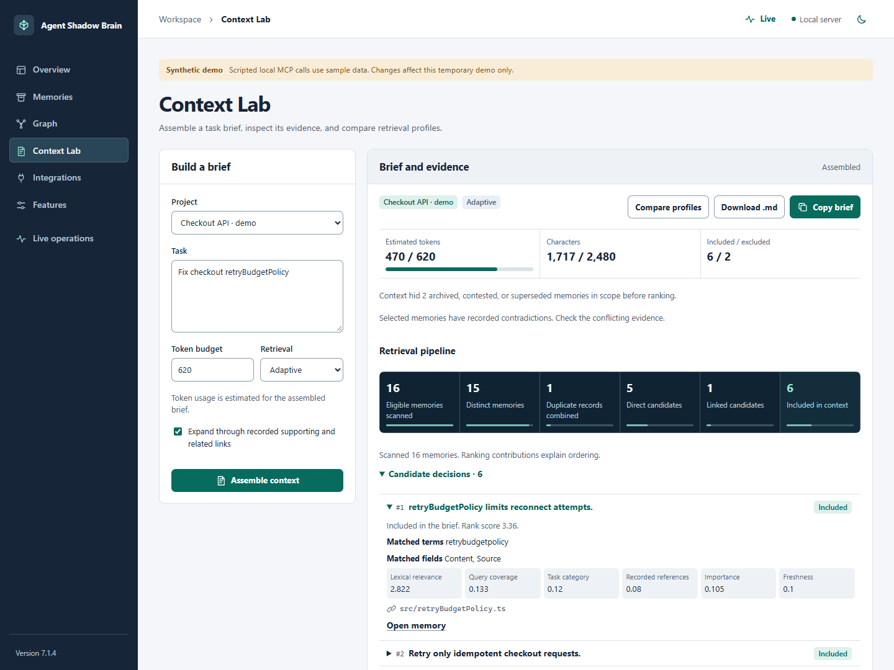

### Compare profiles

Compare the same task and scope with Adaptive and Legacy. The result lists which memories each profile adds and shows their estimated usage.

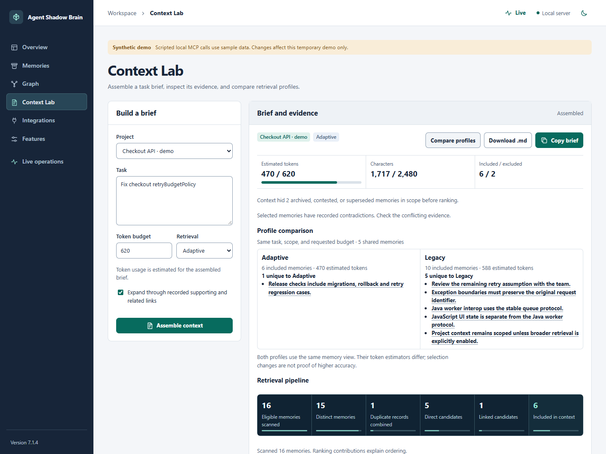

## Memory review and graph

Inspect a saved record, its recorded references, and manual review controls. A review change is recorded in revision history.

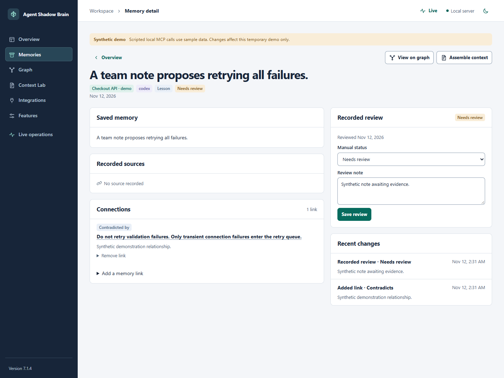

Select an edge or focus the recorded relationships around one memory. The workspace distinguishes these relations from project membership and recording-agent links.

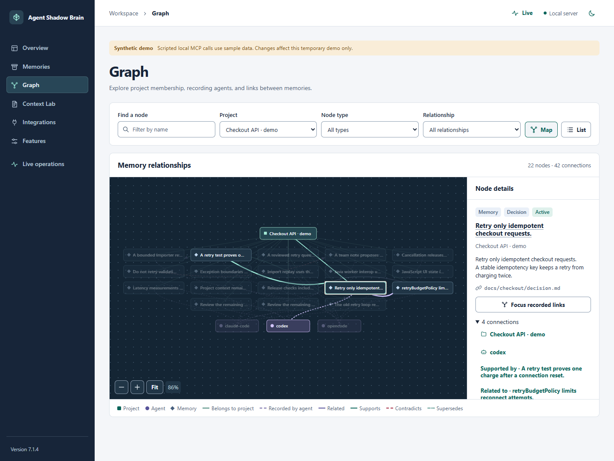

## Integrations and features

Read the documented capabilities and generate a setup example for the client. A project skill-file check and a live client handshake provide different evidence.

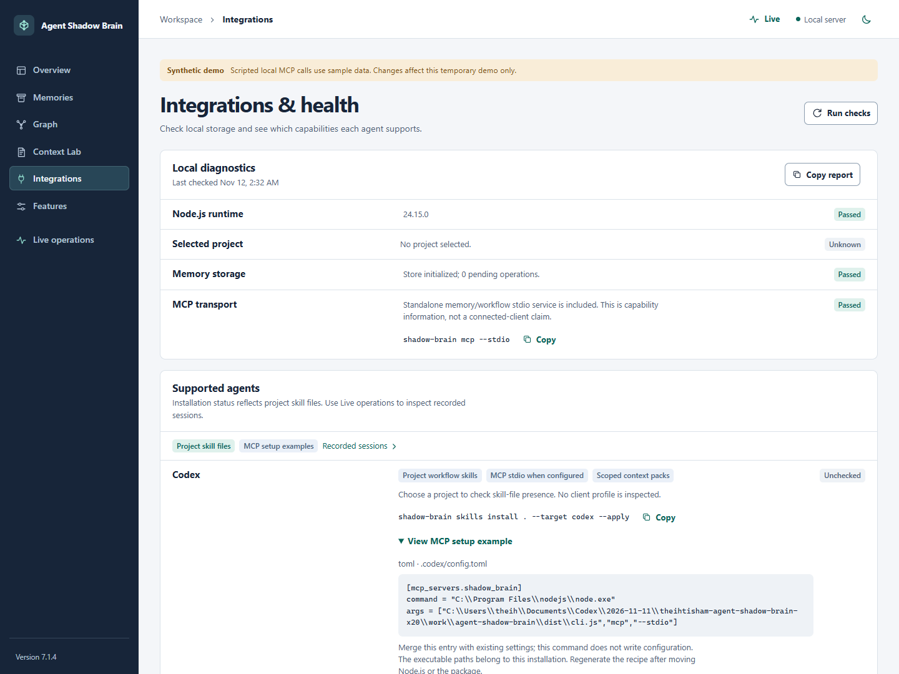

Choose when context, session briefings, and activity are available. The workspace keeps activity visibility and journal recording as separate controls.

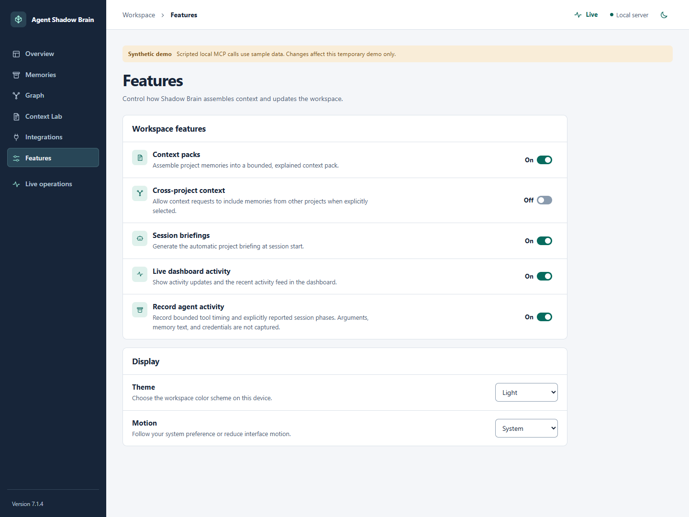

## Live operations and recorded replay

Select a session or event to inspect the available history. The session network, timeline, and charts distinguish measured tool activity from explicit host reports.

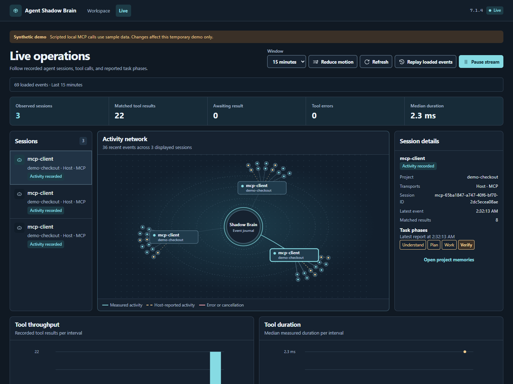

Replay navigates the loaded journal slice. Move to an event with the slider or step controls and return to the live stream when finished.

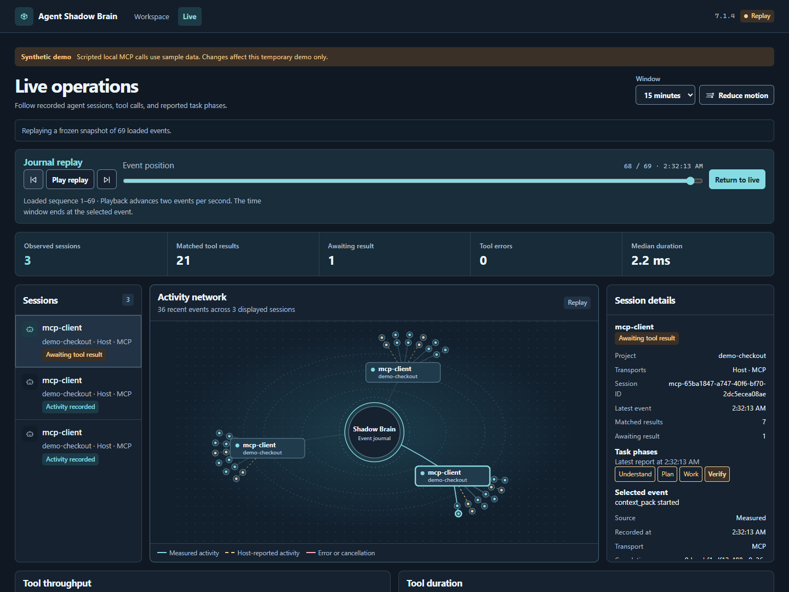

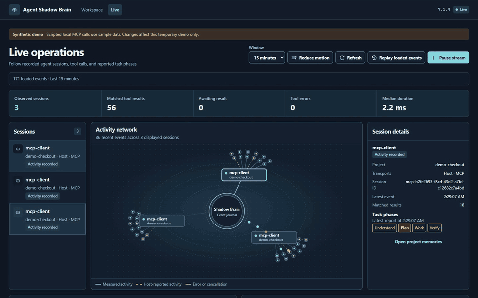

## Mobile layout

Use the workspace on a narrow viewport to inspect the same saved records and context.

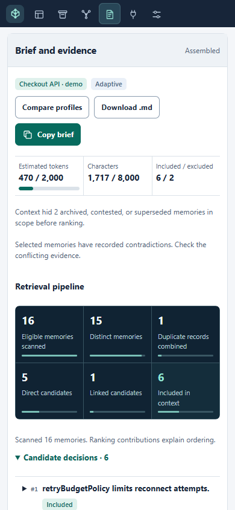

[Project Kit guide](PROJECT_KIT.md) · [Context Lab guide](CONTEXT_LAB.md) · [Workspace guide](WORKSPACE.md) · [Client integrations](INTEGRATIONS.md)
