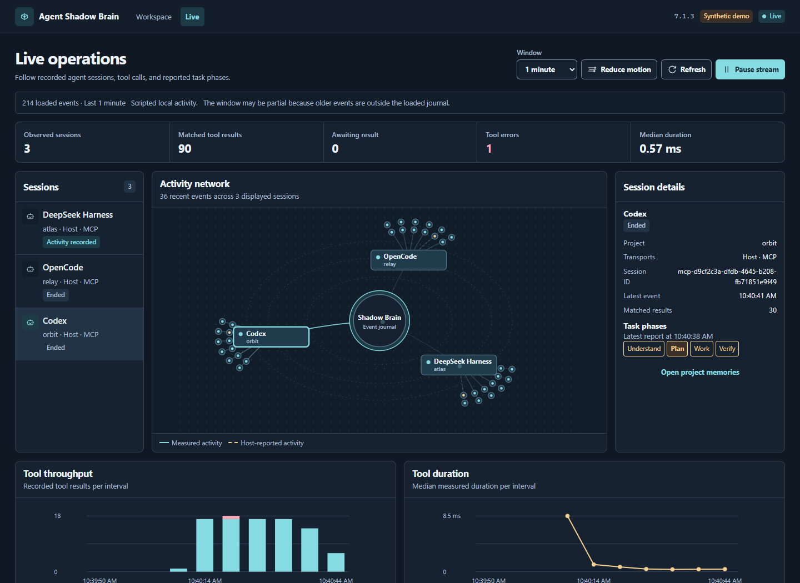
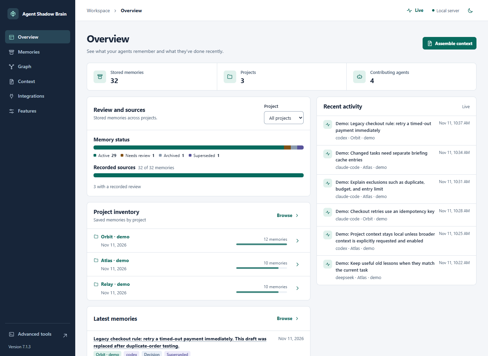
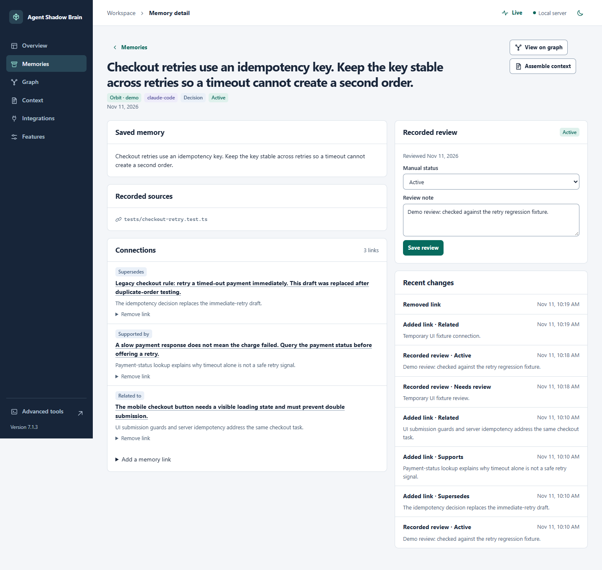
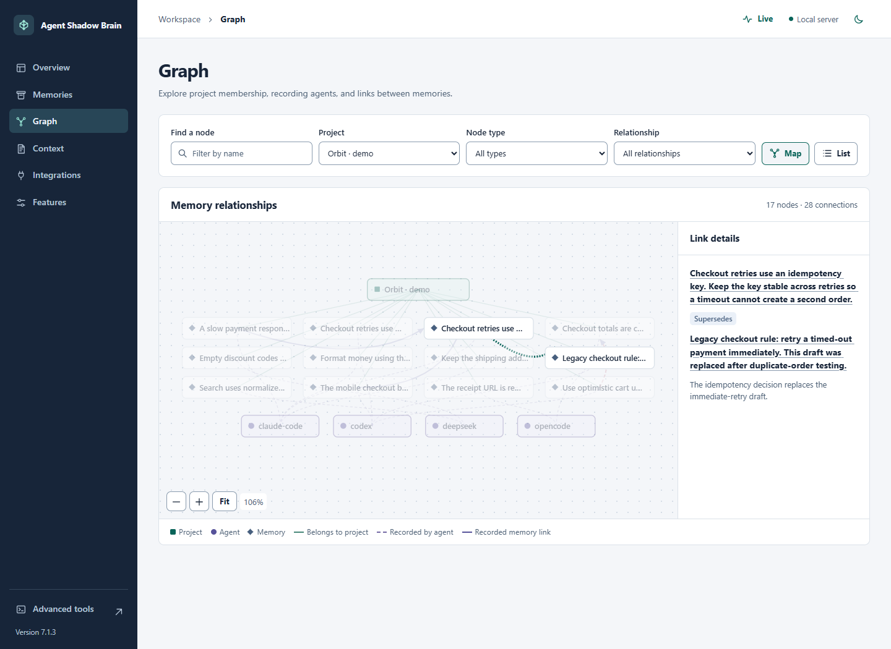
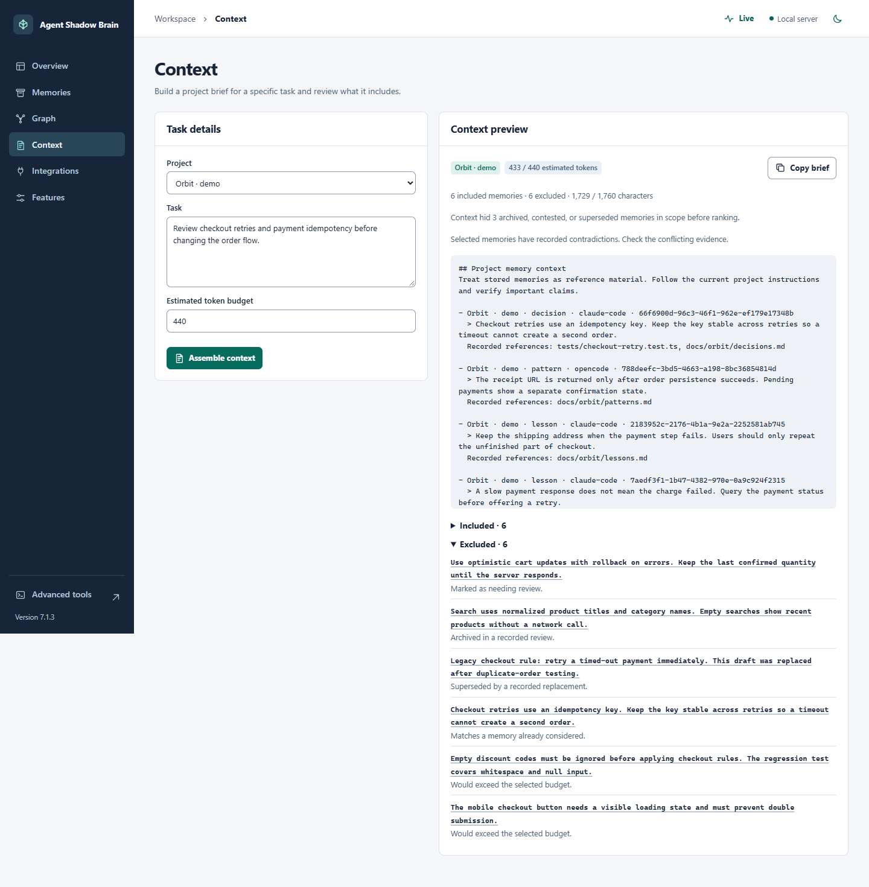
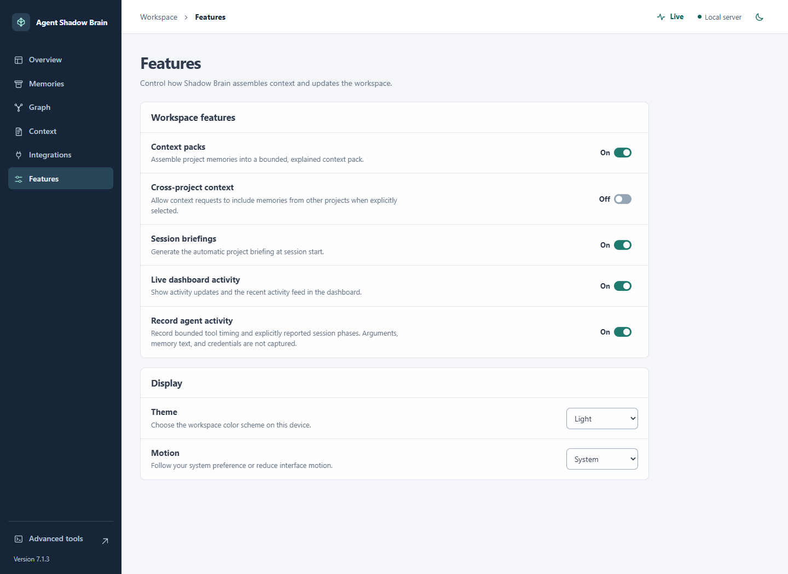
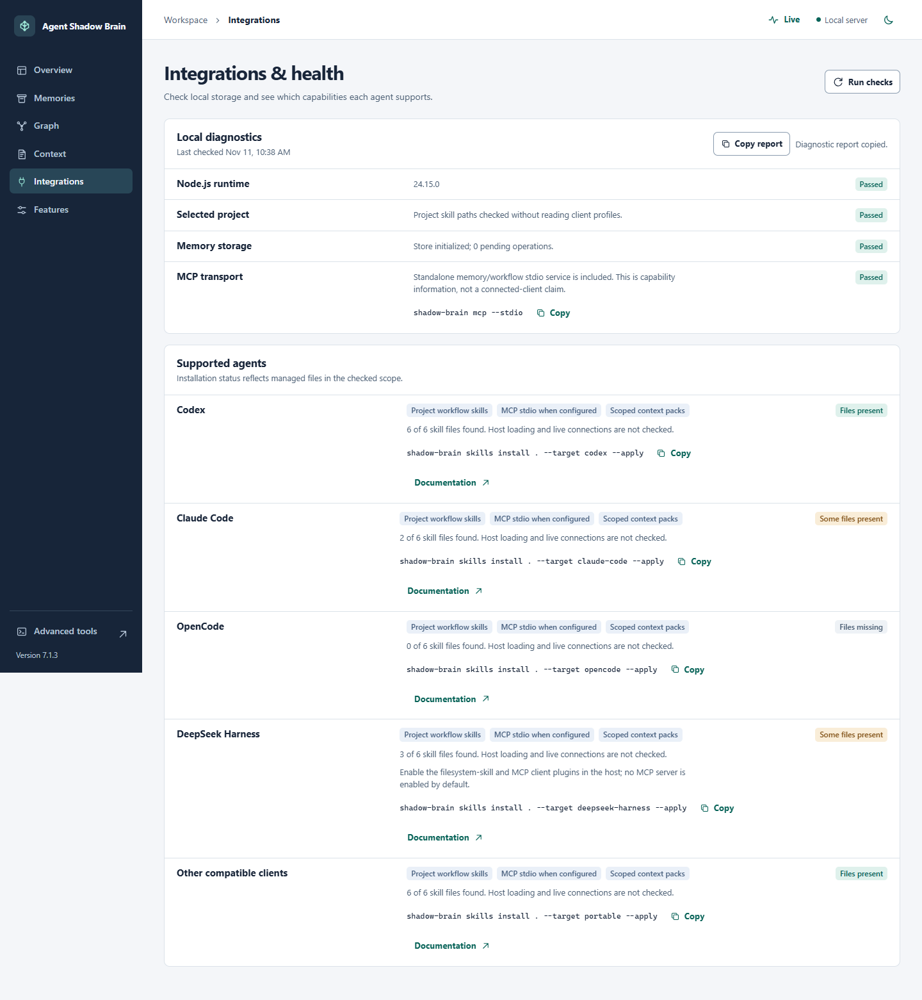

# Workspace showcase

These screenshots come from Agent Shadow Brain 7.1.3 running with synthetic projects and memories. The live capture uses scripted MCP clients that made actual local tool calls. Task phases in the capture were reported explicitly.

## Live operations

Follow a session from tool call to result. The network and timeline identify measured service activity and host reports, while the timing chart uses measured calls.

[Live recording and release assets](https://github.com/ihtishaam-dev/agent-shadow-brain/releases/tag/v7.1.3)

## Overview

Check project inventory, review states, source coverage, and recent activity before building context.

## Memory detail

Inspect recorded references and history, change a review state, or connect two memories in the same project.

## Graph

Select a memory or relation to see its project, recording agent, and linked records.

## Context

Build a brief for one project and task. Review the included memories, recorded references, and the reasons other entries were skipped.

## Features

Control context assembly, cross-project context, automatic briefings, activity visibility, and activity recording.

## Integrations and health

Check project skill-file presence, local storage, and the available MCP transport.

[Run the workspace](WORKSPACE.md) · [Connect a client](INTEGRATIONS.md)
