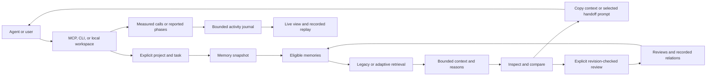

# Component map for 7.1.4

Prepared 2026-11-12 from the repository's source. This map explains the selected release architecture and inventories retained code. **A source file's presence is not a claim that its feature is enabled, integrated into the default workflow, or independently verified.** Final verification belongs in the release evidence report.

## The everyday workflow

The arrows describe data flow. They do not imply that every agent is connected, every tool call is captured, or copied context has been consumed by a model.

## Main components and responsibilities

| Component | Purpose | Boundary |
| --- | --- | --- |
| Global memory store | Persist memory records, project/agent identities, storage health, and recorded use | Schema version 1; atomic writes and bounded store policies |
| Annotation store | Persist reviews, recorded relation types, revisions, and audit history | Explicit review operations; does not verify truth |
| Feature settings | Persist five actual runtime controls | Validated fields and revisions; separate from provider configuration |
| Legacy recall | Keep established substring/ranking behavior available | Ranking is heuristic; legacy compatibility is intentional |
| Adaptive retrieval | Improve technical matching, duplicate handling, excerpts, and bounded recorded-link expansion | Explicit profile; no embeddings or provider call required |
| Context assembler | Apply scope, curation, selection, exclusions, rendering, and output bounds | Stored text is reference material; sources are not opened |
| Memory health | Present scoped counts and actionable review signals | Missing sources, age, and unreviewed status are not truth judgments |
| Subconscious briefing | Supply existing session-start context behavior | Automatic-briefing control applies; profile differences must be documented |
| Workspace API | Validate requests and expose shared results to the local UI | Same scope/review semantics as CLI and MCP; inspections remain read-only |
| Workspace UI | Inspect memory, graph relations, attention queue, context, and integrations | Shows recorded evidence and actual results; does not infer connections |
| MCP stdio | Expose memory/context/workflow tools, resources, and selected prompts | Client capability determines which surfaces are available |
| CLI | Run context, curation, activity, workflow, skill, and diagnostic operations | Explicit flags select new behavior; old commands remain |
| Workflow skills | Give clients focused procedures for selecting, implementing, debugging, reviewing, researching, and releasing work | Installing files does not prove host discovery or execution |
| Client recipes/diagnostics | Produce configuration snippets and inspect managed project skill-file presence | No personal profiles, credentials, or session data are read |
| Activity reporting | Record measured MCP calls and explicitly reported phases/spans | Records bounded metadata, not model thoughts or a complete host trace |
| Durable activity journal | Persist the latest bounded events with sequence and journal identity | Readers can detect gaps and restarts |
| Live portal | Show sessions, events, networks, timing, and recorded playback | A replay is historical; measured and reported events remain distinct |
| Isolated workspace demo | Serve the real UI with synthetic records and scripted local calls through `demo workspace` | Separate temporary store; no client discovery or personal provider configuration |
| Project Kit (added scope) | Inspect a chosen project's stack evidence, save explicit local knowledge, and preview/apply a requirement-specific skill | Persistent project store and project skill roots; no automatic source ingestion, global installation, or overwrite of user edits; implementation acceptance pending |
| Project feedback (added scope) | Persist attributed task outcomes and make bounded, reversible adjustments to relevant adaptive candidates | Project-only sidecar; reported evidence, no model training, truth verification, automatic curation, or global influence; implementation acceptance pending |
| Package/library exports | Supply CLI binaries and public TypeScript/JavaScript entry points | Verify the packed artifact in a fresh consumer |

## Persistent project workflow

`project workspace` creates an independent memory service pinned to the selected directory. `project-memory.ts` supplies canonical store paths and explicit knowledge writes. `project-kit-inspection.ts` extracts bounded observed markers; `project-kit-paths.ts` checks roots, links, and bounded reads; `project-kit.ts` produces requirement-specific previews and protects applied files with ownership receipts. `project-feedback.ts` owns local outcome persistence and relevance adjustments. The portal, CLI, and MCP use these shared services.

Knowledge and outcomes persist under `.shadow-brain` in the selected project. Generated skill files use the selected client's project skill directory. The local portal must not consume another store's process-wide activity feed. Its MCP recipe includes the exact database and project identity. This persistent workflow is separate from the disposable `demo workspace` tour.

The project learning flag is a local feedback-store control, separate from the five global feature controls below. Its meaning is whether reported outcomes influence adaptive retrieval; switching it off retains the reports. See the [Project Kit plan](PROJECT_KIT_PLAN_v7.1.4.md) and [learning plan](PROJECT_LEARNING_PLAN_v7.1.4.md) for acceptance gates.

## Controls and their effects

| Control | Default | Effect |
| --- | --- | --- |
| Context assembly | On | Allows the shared context pack path; disabled requests return before recall |
| Cross-project context | Off | Permits broader scope only together with an explicit request |
| Automatic briefing | On | Allows the existing session-start briefing path |
| Live dashboard activity | On | Allows activity to be shown/refreshed in the dashboard |
| Record agent activity | On | Allows new bounded activity-journal records |

Visibility and recording are different. Disabling visibility does not erase recorded events. Per-request retrieval profile and relation expansion are request options, not extra persisted global switches.

## What a connection proves

| Observation | What it establishes |
| --- | --- |
| Client appears in capability list | A documented recipe or supported layout exists |
| Skill file is present | The managed project file exists at the inspected path |
| MCP handshake and tool list succeed | That process can speak the advertised protocol |
| Host reports a phase | The host explicitly submitted that metadata |
| Server measures a tool call | The local server observed that call and its timing |
| User sees a completed host interaction | That particular client workflow operated end to end |

Do not collapse these observations into an unqualified green “connected” badge. Prompts, resources, and tools have different support across clients.

## Retained advanced code

The repository also exports or retains analyzers, memory experiments, team/swarm concepts, graph algorithms, portability, dashboards, speech/visual experiments, and legacy continuity paths. These remain available according to their existing entry points and configuration. Their names are not evidence of general intelligence, autonomous learning, formal correctness, or complete integration with adaptive context.

The `src/index.ts` export surface and CLI/server entry points are the authoritative starting points for checking accessibility. The source inventory below makes every module discoverable without expanding the README into a feature catalogue. Refer to focused tests and release evidence before making a stronger capability claim.

## Source inventory

This inventory is generated from source filenames. It classifies location, not verification status. New 7.1.4 files should be included again when the final package is prepared.

### src

- [project-cli.ts](../../src/project-cli.ts)

- [activity-cli.ts](../../src/activity-cli.ts)
- [cli.ts](../../src/cli.ts)
- [context-cli.ts](../../src/context-cli.ts)
- [curation-cli.ts](../../src/curation-cli.ts)
- [index.ts](../../src/index.ts)
- [integration-cli.ts](../../src/integration-cli.ts)
- [types.ts](../../src/types.ts)
- [workflow-cli.ts](../../src/workflow-cli.ts)

### src/brain

- [project-feedback.ts](../../src/brain/project-feedback.ts)
- [project-kit.ts](../../src/brain/project-kit.ts)
- [project-kit-inspection.ts](../../src/brain/project-kit-inspection.ts)
- [project-kit-paths.ts](../../src/brain/project-kit-paths.ts)
- [project-memory.ts](../../src/brain/project-memory.ts)

- [accessibility-checker.ts](../../src/brain/accessibility-checker.ts)
- [activity-journal.ts](../../src/brain/activity-journal.ts)
- [activity-reporting.ts](../../src/brain/activity-reporting.ts)
- [adr-engine.ts](../../src/brain/adr-engine.ts)
- [adversarial-defense.ts](../../src/brain/adversarial-defense.ts)
- [agent-firewall.ts](../../src/brain/agent-firewall.ts)
- [agent-handoff.ts](../../src/brain/agent-handoff.ts)
- [air-gap.ts](../../src/brain/air-gap.ts)
- [analyzer.ts](../../src/brain/analyzer.ts)
- [api-contract-analyzer.ts](../../src/brain/api-contract-analyzer.ts)
- [ast-analyzer.ts](../../src/brain/ast-analyzer.ts)
- [attention-heatmap.ts](../../src/brain/attention-heatmap.ts)
- [auto-setup.ts](../../src/brain/auto-setup.ts)
- [auto-update.ts](../../src/brain/auto-update.ts)
- [brain-3d.ts](../../src/brain/brain-3d.ts)
- [brain-active-learner.ts](../../src/brain/brain-active-learner.ts)
- [brain-ascii.ts](../../src/brain/brain-ascii.ts)
- [brain-bus.ts](../../src/brain/brain-bus.ts)
- [brain-chat.ts](../../src/brain/brain-chat.ts)
- [brain-cinema.ts](../../src/brain/brain-cinema.ts)
- [brain-coach.ts](../../src/brain/brain-coach.ts)
- [brain-consolidator.ts](../../src/brain/brain-consolidator.ts)
- [brain-contradictions.ts](../../src/brain/brain-contradictions.ts)
- [brain-diff.ts](../../src/brain/brain-diff.ts)
- [brain-dna.ts](../../src/brain/brain-dna.ts)
- [brain-doppelganger.ts](../../src/brain/brain-doppelganger.ts)
- [brain-encryption.ts](../../src/brain/brain-encryption.ts)
- [brain-exchange.ts](../../src/brain/brain-exchange.ts)
- [brain-garden.ts](../../src/brain/brain-garden.ts)
- [brain-graph-walker.ts](../../src/brain/brain-graph-walker.ts)
- [brain-holiday-card.ts](../../src/brain/brain-holiday-card.ts)
- [brain-memes.ts](../../src/brain/brain-memes.ts)
- [brain-memory-tiers.ts](../../src/brain/brain-memory-tiers.ts)
- [brain-notebook.ts](../../src/brain/brain-notebook.ts)
- [brain-portability.ts](../../src/brain/brain-portability.ts)
- [brain-quantize.ts](../../src/brain/brain-quantize.ts)
- [brain-query-expander.ts](../../src/brain/brain-query-expander.ts)
- [brain-quest.ts](../../src/brain/brain-quest.ts)
- [brain-recall-cache.ts](../../src/brain/brain-recall-cache.ts)
- [brain-reflex.ts](../../src/brain/brain-reflex.ts)
- [brain-replay.ts](../../src/brain/brain-replay.ts)
- [brain-rerank.ts](../../src/brain/brain-rerank.ts)
- [brain-roast.ts](../../src/brain/brain-roast.ts)
- [brain-sonification.ts](../../src/brain/brain-sonification.ts)
- [brain-tarot.ts](../../src/brain/brain-tarot.ts)
- [brain-time-capsule.ts](../../src/brain/brain-time-capsule.ts)
- [brain-trophies.ts](../../src/brain/brain-trophies.ts)
- [brain-working-memory.ts](../../src/brain/brain-working-memory.ts)
- [branch-brain.ts](../../src/brain/branch-brain.ts)
- [calibration-monitor.ts](../../src/brain/calibration-monitor.ts)
- [causal-chains.ts](../../src/brain/causal-chains.ts)
- [client-config.ts](../../src/brain/client-config.ts)
- [client-integrations.ts](../../src/brain/client-integrations.ts)
- [code-age-analyzer.ts](../../src/brain/code-age-analyzer.ts)
- [code-dna.ts](../../src/brain/code-dna.ts)
- [code-metrics.ts](../../src/brain/code-metrics.ts)
- [code-similarity.ts](../../src/brain/code-similarity.ts)
- [cognitive-load.ts](../../src/brain/cognitive-load.ts)
- [collective-learning.ts](../../src/brain/collective-learning.ts)
- [collision-detective.ts](../../src/brain/collision-detective.ts)
- [confidence-gate.ts](../../src/brain/confidence-gate.ts)
- [config-drift-detector.ts](../../src/brain/config-drift-detector.ts)
- [consensus-engine.ts](../../src/brain/consensus-engine.ts)
- [constitution.ts](../../src/brain/constitution.ts)
- [context-assembly.ts](../../src/brain/context-assembly.ts)
- [context-completion.ts](../../src/brain/context-completion.ts)
- [context-continuity.ts](../../src/brain/context-continuity.ts)
- [context-recall.ts](../../src/brain/context-recall.ts)
- [context-request.ts](../../src/brain/context-request.ts)
- [context-retrieval.ts](../../src/brain/context-retrieval.ts)
- [cost-aware-spawner.ts](../../src/brain/cost-aware-spawner.ts)
- [cross-agent-protocol.ts](../../src/brain/cross-agent-protocol.ts)
- [custom-rules.ts](../../src/brain/custom-rules.ts)
- [dead-code-eliminator.ts](../../src/brain/dead-code-eliminator.ts)
- [dependency-graph.ts](../../src/brain/dependency-graph.ts)
- [dream-engine.ts](../../src/brain/dream-engine.ts)
- [embeddings-v2.ts](../../src/brain/embeddings-v2.ts)
- [embeddings.ts](../../src/brain/embeddings.ts)
- [env-analyzer.ts](../../src/brain/env-analyzer.ts)
- [feature-settings.ts](../../src/brain/feature-settings.ts)
- [fine-tuning-engine.ts](../../src/brain/fine-tuning-engine.ts)
- [forgetting-curve.ts](../../src/brain/forgetting-curve.ts)
- [formal-verification-bridge.ts](../../src/brain/formal-verification-bridge.ts)
- [framework-presets.ts](../../src/brain/framework-presets.ts)
- [global-brain.ts](../../src/brain/global-brain.ts)
- [hallucination-quarantine.ts](../../src/brain/hallucination-quarantine.ts)
- [health-score.ts](../../src/brain/health-score.ts)
- [hierarchical-memory.ts](../../src/brain/hierarchical-memory.ts)
- [hive-accelerator.ts](../../src/brain/hive-accelerator.ts)
- [hive-voice.ts](../../src/brain/hive-voice.ts)
- [i18n-detector.ts](../../src/brain/i18n-detector.ts)
- [influence-map.ts](../../src/brain/influence-map.ts)
- [intent-engine.ts](../../src/brain/intent-engine.ts)
- [json-output.ts](../../src/brain/json-output.ts)
- [knowledge-graph.ts](../../src/brain/knowledge-graph.ts)
- [l0-cache.ts](../../src/brain/l0-cache.ts)
- [learning-engine.ts](../../src/brain/learning-engine.ts)
- [license-compliance.ts](../../src/brain/license-compliance.ts)
- [live-brain.ts](../../src/brain/live-brain.ts)
- [llm-client.ts](../../src/brain/llm-client.ts)
- [local-llm.ts](../../src/brain/local-llm.ts)
- [lsp-server.ts](../../src/brain/lsp-server.ts)
- [markdown-export.ts](../../src/brain/markdown-export.ts)
- [mcp-server.ts](../../src/brain/mcp-server.ts)
- [mcp-stdio.ts](../../src/brain/mcp-stdio.ts)
- [memory-annotations.ts](../../src/brain/memory-annotations.ts)
- [memory-graph.ts](../../src/brain/memory-graph.ts)
- [memory-inspection.ts](../../src/brain/memory-inspection.ts)
- [memory-mcp-content.ts](../../src/brain/memory-mcp-content.ts)
- [memory-seeder.ts](../../src/brain/memory-seeder.ts)
- [memory-sources.ts](../../src/brain/memory-sources.ts)
- [model-registry.ts](../../src/brain/model-registry.ts)
- [multi-project.ts](../../src/brain/multi-project.ts)
- [multimodal-vision.ts](../../src/brain/multimodal-vision.ts)
- [mutation-advisor.ts](../../src/brain/mutation-advisor.ts)
- [neural-mesh.ts](../../src/brain/neural-mesh.ts)
- [notifier.ts](../../src/brain/notifier.ts)
- [orchestrator.ts](../../src/brain/orchestrator.ts)
- [otel-lite.ts](../../src/brain/otel-lite.ts)
- [pattern-memory.ts](../../src/brain/pattern-memory.ts)
- [perf-profiler.ts](../../src/brain/perf-profiler.ts)
- [plugin-system.ts](../../src/brain/plugin-system.ts)
- [pr-auto-review.ts](../../src/brain/pr-auto-review.ts)
- [pr-generator.ts](../../src/brain/pr-generator.ts)
- [pre-mortem.ts](../../src/brain/pre-mortem.ts)
- [predictive-engine.ts](../../src/brain/predictive-engine.ts)
- [project-config.ts](../../src/brain/project-config.ts)
- [project-context.ts](../../src/brain/project-context.ts)
- [prompt-cache.ts](../../src/brain/prompt-cache.ts)
- [report-generator.ts](../../src/brain/report-generator.ts)
- [reputation-ledger.ts](../../src/brain/reputation-ledger.ts)
- [security-audit.ts](../../src/brain/security-audit.ts)
- [self-evolution.ts](../../src/brain/self-evolution.ts)
- [semantic-analyzer.ts](../../src/brain/semantic-analyzer.ts)
- [session-hooks.ts](../../src/brain/session-hooks.ts)
- [smart-cache.ts](../../src/brain/smart-cache.ts)
- [smart-fix.ts](../../src/brain/smart-fix.ts)
- [sssp-router.ts](../../src/brain/sssp-router.ts)
- [subagent-bridge.ts](../../src/brain/subagent-bridge.ts)
- [subconscious.ts](../../src/brain/subconscious.ts)
- [swarm-debate.ts](../../src/brain/swarm-debate.ts)
- [swarm-intelligence.ts](../../src/brain/swarm-intelligence.ts)
- [task-workflow.ts](../../src/brain/task-workflow.ts)
- [team-brain-sync.ts](../../src/brain/team-brain-sync.ts)
- [team-mode.ts](../../src/brain/team-mode.ts)
- [temporal-intelligence.ts](../../src/brain/temporal-intelligence.ts)
- [token-economy.ts](../../src/brain/token-economy.ts)
- [turbo-memory.ts](../../src/brain/turbo-memory.ts)
- [type-safety.ts](../../src/brain/type-safety.ts)
- [voice-mode.ts](../../src/brain/voice-mode.ts)
- [vuln-scanner.ts](../../src/brain/vuln-scanner.ts)
- [workflow-skills.ts](../../src/brain/workflow-skills.ts)

### src/dashboard

- [project-feedback-html.ts](../../src/dashboard/project-feedback-html.ts)
- [project-kit-html.ts](../../src/dashboard/project-kit-html.ts)
- [project-workspace.ts](../../src/dashboard/project-workspace.ts)

- [demo-workspace.ts](../../src/dashboard/demo-workspace.ts)
- [live-workspace-html.ts](../../src/dashboard/live-workspace-html.ts)
- [server.ts](../../src/dashboard/server.ts)
- [v6-dashboard-html.ts](../../src/dashboard/v6-dashboard-html.ts)
- [workspace-api.ts](../../src/dashboard/workspace-api.ts)
- [workspace-html.ts](../../src/dashboard/workspace-html.ts)

### src/adapters

- [aider.ts](../../src/adapters/aider.ts)
- [base-adapter.ts](../../src/adapters/base-adapter.ts)
- [claude-code.ts](../../src/adapters/claude-code.ts)
- [cline.ts](../../src/adapters/cline.ts)
- [codex.ts](../../src/adapters/codex.ts)
- [copilot.ts](../../src/adapters/copilot.ts)
- [cursor.ts](../../src/adapters/cursor.ts)
- [index.ts](../../src/adapters/index.ts)
- [kilo-code.ts](../../src/adapters/kilo-code.ts)
- [opencode.ts](../../src/adapters/opencode.ts)
- [roo-code.ts](../../src/adapters/roo-code.ts)
- [windsurf.ts](../../src/adapters/windsurf.ts)

### src/watchers

- [file-watcher.ts](../../src/watchers/file-watcher.ts)
- [git-watcher.ts](../../src/watchers/git-watcher.ts)

### src/ui

- [dashboard.tsx](../../src/ui/dashboard.tsx)
